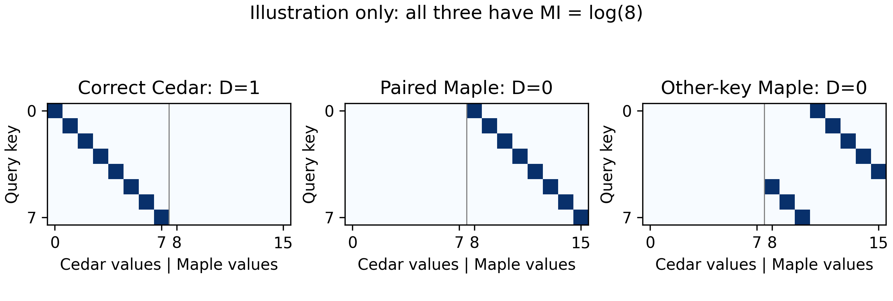
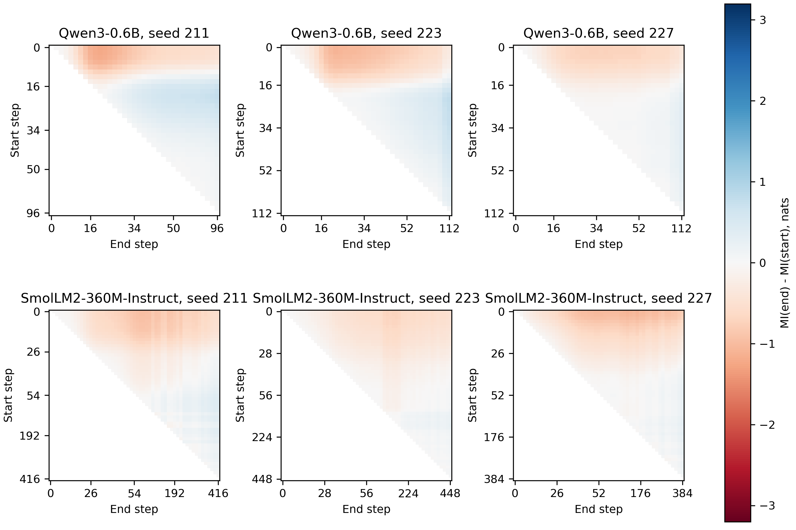
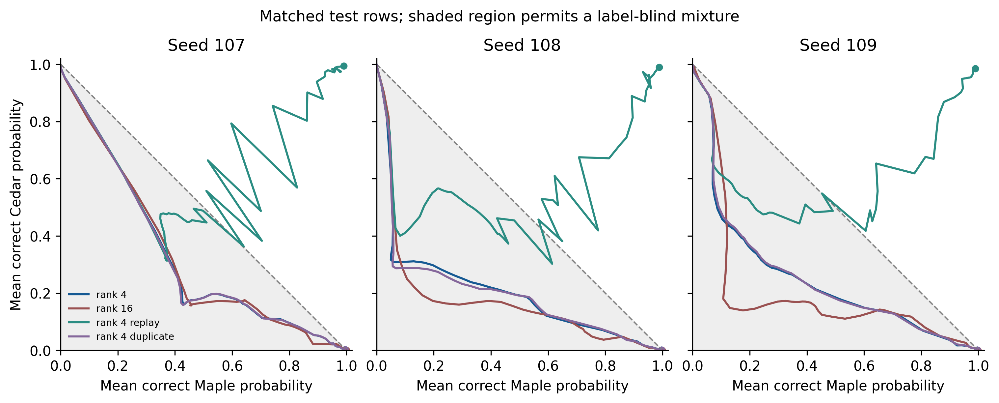

# 概率混合审计与第二轮修订状态

本文件替代前一稿关于低目标回放能说明条件化的解释。旧版 PDF 和 release 保留为历史快照；第二轮高目标与新锚点实验尚在执行，不能引用为已完成结果。

> **当前主要发现**
>
> 1. 低目标处的旧值质量可落在注册表盲混合界内，不能单独证明条件化。
> 2. 同一键、同一上下文下，Σ>0 能排除完全标签盲的输出分布；Σ≤0 不能反向证明模型标签盲。正 JS 也不能保证正确路由。
> 3. 旧种子的 640 步等预算比较已完成：回放在三个种子上均越过盲混合界；普通训练、rank 16 和重复 Maple 对照没有做到。打散配对的新锚点仍在逐个运行。

## 符号与比较单位

图为理想确定映射，不是实测结果。旧值对角线、平移至同键 Maple 列的对角线、再按键置换的新值对角线均保留键的信息，但只有第一种映射答对 Cedar。

|符号|含义|
|---|---|
|K|活跃原题键；主分析为同一批 16 个键|
|c_K、m_K|该键在 Cedar、Maple 注册表的正确规范完成序列|
|D|Cedar 标签下正确 Cedar 序列概率的算术平均|
|M|Maple 标签下正确 Maple 序列概率的算术平均|
|Σ|D+M−1；使用同一键和上下文集合|
|TV、JS|逐题共同粗化候选分布的总变差与 Jensen–Shannon 散度，然后取平均；JS 单位 nats|
|有符号 Cedar 路由|P(c_K\|Cedar)−P(c_K\|Maple) 的平均|
|logP|包含 EOS 的正确规范完成序列对数概率；验证平均不等同于贪心准确率|

两种正确答案互斥。标签盲模型有 D+M≤1。一般情况下，Σ≤平均 TV≤√(2·平均 JS)。因此 D/(1−M)>1 与 Σ>0 给出相同方向的信息，不将其作为一个独立创新指标。其余桶保留全部未覆盖质量。

## 已完成的离线审计

对原 33 条轨迹重算同键同上下文的 D、M、Σ、TV、JS、有符号路由和完整质量预算。非线性量在插值后的概率矩阵上重新计算。每条轨迹同时报告原始首次越过与回顾性 PAVA 单调拟合，缺失高目标不外推。

对旧锚点 107–109 的 rank-4 回放，在 −1.0 目标处，活跃键 D 的种子均值为 46.30%、M 为 47.12%，平均 Σ=−0.0658。这些均值不支持“61% 旧值保持说明已学会标签条件化”的旧解释。原 61% 是 24 键汇总，不应与只在 16 个键上汇总的新任务概率直接相加。

在 −0.5 处，活跃键的 D 均值为 51.66%、M 为 68.28%，平均 Σ=+0.1993。这只是已多次分析的三个旧锚点的探索性结果。种子内先计算比值再取平均，与用跨种子均值计算 D/(1−M) 不同；完整逐种子值与覆盖数均在审计表中给出。

完整预算区分：正确 Cedar、其他 Cedar、同键 Maple、同题族换键 Maple、其他活跃原题 Maple、其他活跃换键 Maple、非活跃 Maple、其余；每行总和核对为 1。

窗口审计对两个模型的所有已记录 t1<t2 绘制 ΔMI 热图，不再选一个有利窗口代替不支持的固定窗口。键邻近分析另做 2000 次键坐标置换，在矩阵和数值答案不变的条件下计算零分布；这是探索性检验，不把索引距离解释为隐藏语义距离。

[完整逐种子审计与质量预算](https://github.com/soloduist-pixiv/lora-binding-interference/blob/main/outputs/binding_revision2_20261111/离线审计.md)；[键序置换零分布](https://github.com/soloduist-pixiv/lora-binding-interference/blob/main/outputs/binding_revision2_20261111/key_coordinate_null.json)。

## 已完成的固定预算参照

已完成 12 个固定 640 步分支：三个旧种子各有 rank-4 普通、rank-16 普通、rank-4 回放续训和重复 Maple 对照；已有 rank-16 回放终点作参照。在相同 16 个活跃原题键和两个测试上下文上，rank-4 回放的 D 为 98.51%–99.49%、M 为 98.92%–99.07%，Σ 为 +0.9742 至 +0.9856。有符号 Cedar 路由为 0.9802–0.9903，因此这里的标签效应有正确方向，且不是低目标处的概率混合。

普通 rank-4 的 D 仅为 0.093%–0.201%；重复同一四条 Maple 到八条的分支为 0.089%–0.210%；rank-16 普通为 0.014%–0.036%。这支持旧样本内容对这一设置的重要性。重复样本对照在数学上与普通分支具有相同 token 平均梯度，是重复暴露/批次形状的负参照；它不能排除所有形式的批量与多样性效应。这些仍是三个已多次分析的旧种子及相邻配对，不能替代新种子的打散实验。

[逐种子等预算表与 −1.0 原生贪心解码](https://github.com/soloduist-pixiv/lora-binding-interference/blob/main/outputs/binding_revision2_20261111/固定预算对照.md)。

## 新锚点进度

随后使用八个新种子，在支持集保持打散条件下执行 lr×rank×回放的 96 个分支，并加八个重复 Maple 对照。高目标为 −0.3、−0.1，至少 640、最多 1280 步；新锚点开始前追加了验证平台期停机规格，使用验证集两窗口均值变化与波动判断，并要求连续两次通过，未通过者仍标记预算终点，不冒称数学收敛。运行异常停止队列、不换种子。全部训练仅用 Qwen3-0.6B 并串行运行。

当前首个新种子 401 的 lr=1e-4、rank-4 两臂已经完成。在 −0.1 的 PAVA 验证进度对齐处，普通分支 D=0.60%、M=87.82%、Σ=−0.1158，回放为 D=93.42%、M=85.52%、Σ=+0.7893；回放减普通的 D 差为 +92.82 pp。目标来自独立验证上下文，因此测试集算术 M 不必等于 exp(−0.1)。这只有一个配对，八个预定锚点尚未完成，不能用作总体确认性数字。所有缺失、目标未覆盖、方向计数在[持续更新的逐种子配对表](https://github.com/soloduist-pixiv/lora-binding-interference/blob/main/outputs/binding_revision2_20261111/新锚点配对差.md)中保留。

## 主张—证据—对照

|主张|当前证据|对照与状态|
|---|---|---|
|互信息较高不保证旧答案正确|候选映射示意与历史轨迹的质量分解|恒等式和诊断不是新算法；历史种子及配对结构限制保留|
|低目标的较高旧质量不足以证明标签条件化|同一观测集合重算 D、M、Σ|撤回跨集合相加及低目标解释；离线审计已完成|
|旧样本回放能在充分更新后形成有方向的注册表路由|三个旧种子 rank-4 回放的匹配 640 步终点 Σ>0.97|普通、rank-16、重复 Maple 等步数参照已完成；不能推广至打散新种子|
|打散配对下回放与学习率的效果可跨新锚点复现|预定八锚点的配对差和方向数|仅部分分支完成，尚不作总体主张|
|该现象不限于末四层 Q/V 或数字答案|扩大 LoRA 范围、单 token 和真实事实方案已冻结|GPU 技术检查与正式辅助训练尚未完成|

## 尚未完成

全层 Q/V、全线性层、封闭单 token 词表、真实时间事实、三个注册表序列及新摘要的确认性数字仍未完成。48 个单 token 词及 8 个真实职位×3 日期的输入已冻结，来源记录为 temporal_fact_sources.json；数据校验不是训练结果。后续队列在原 116 个任务全部成功后才启动，协议中单列登记时间与探索性身份。旧非数值臂退出主要结论。新增六篇相关文献已核对原始来源；原有 20 条引文现均已补齐 arXiv ID 或出版方 DOI，见 reference_identifiers.md。

可审阅材料：[公开协议](https://github.com/soloduist-pixiv/lora-binding-interference/blob/main/paper/revision2_protocol.md)。本地完整审计位于 outputs/binding_revision2_20261111；该目录是本轮结果，不覆盖上一轮原始数据。
