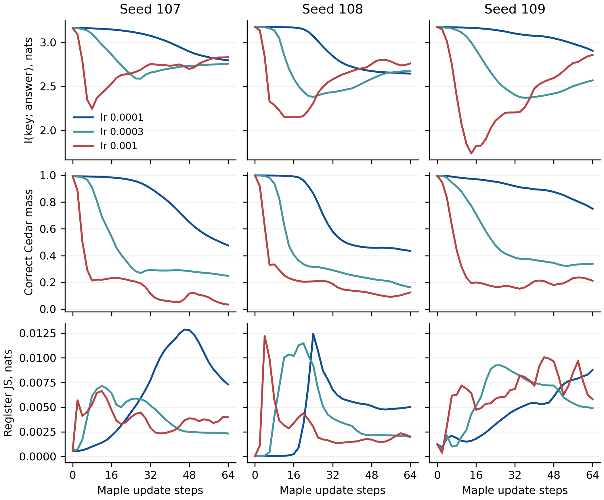
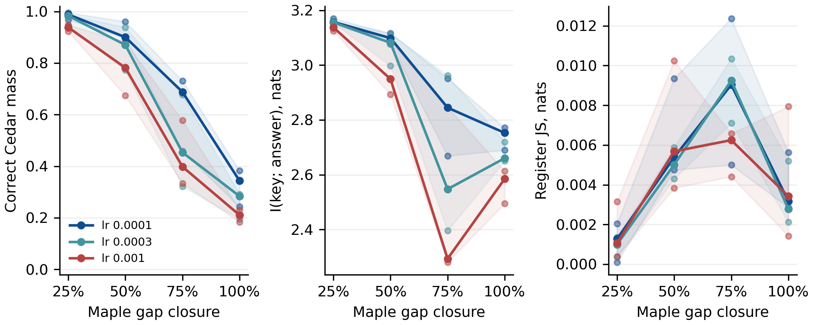
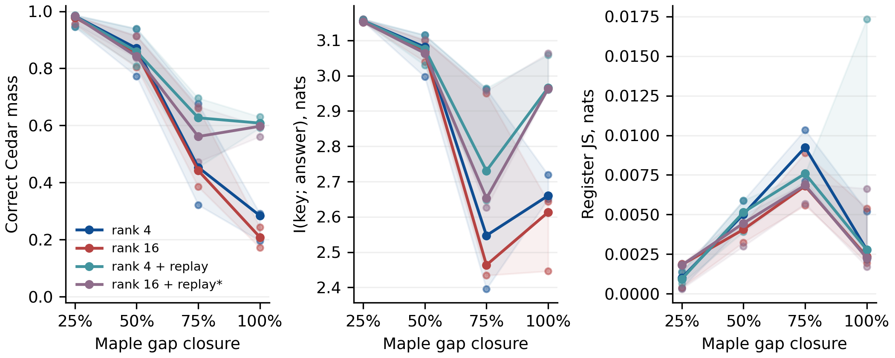
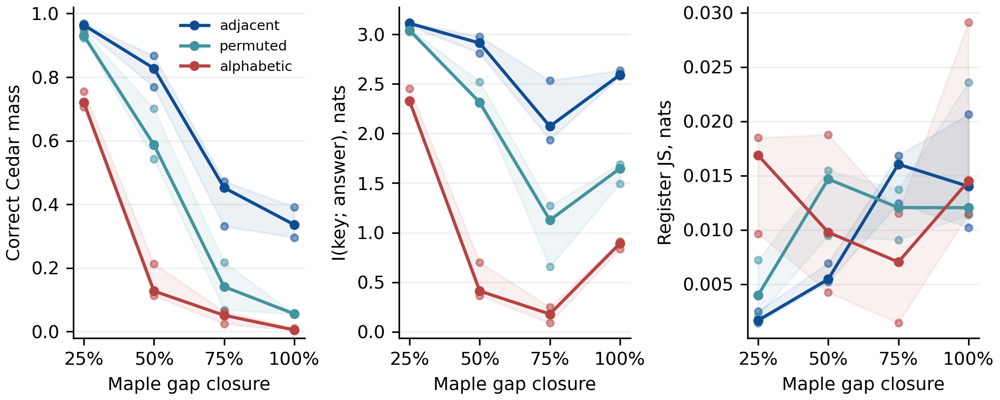
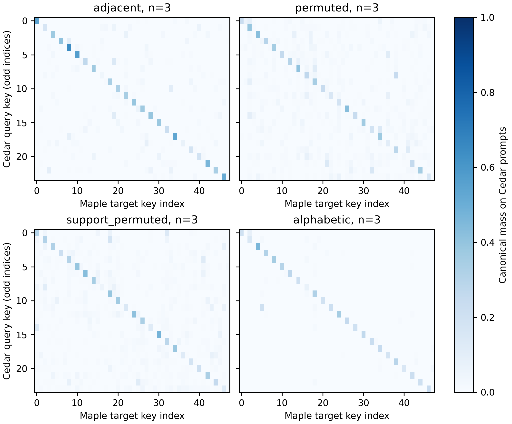
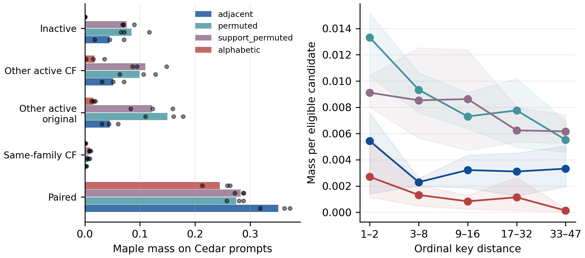
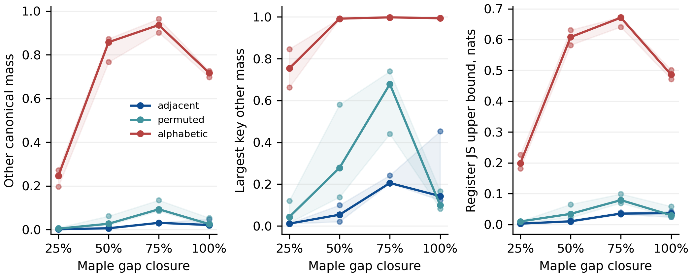
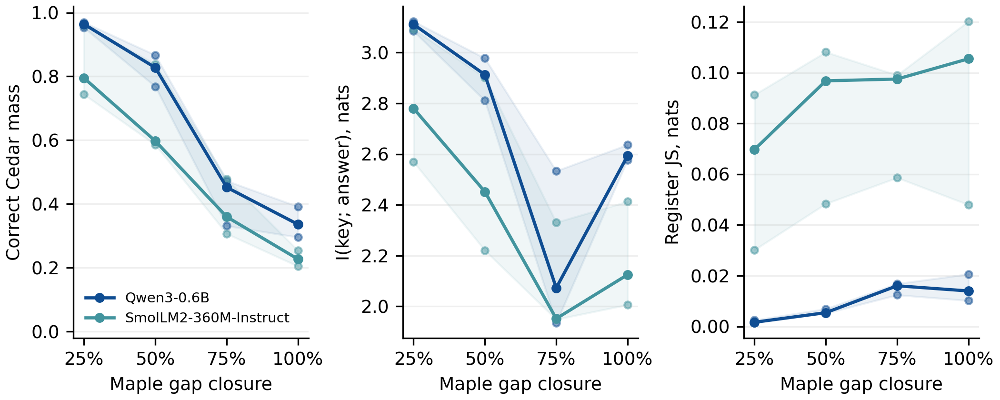
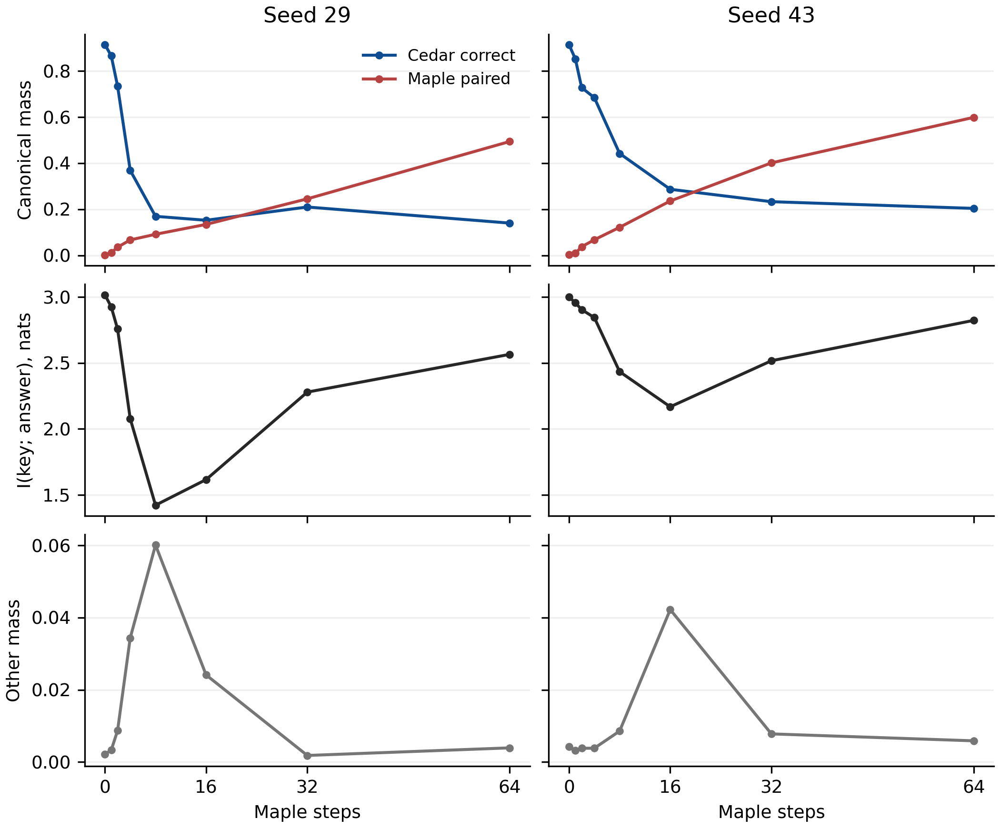
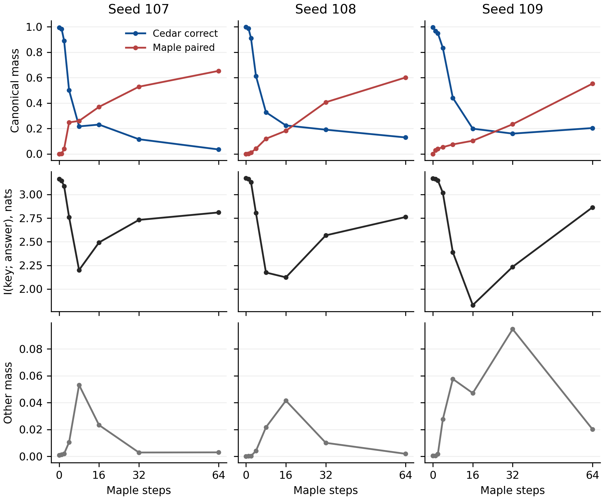

# 共享 LoRA 顺序学习中的事实绑定干扰

*Factual Binding Interference during Sequential Low-Rank Adaptation*

2026 年 11 月 11 日修订工作稿。

## 摘要

共享 LoRA 顺序学习后，输出对查询键的区分与对旧事实的正确保持可能分离。我们在两套同时有效的合成注册表中分解键与答案的互信息，固定权重替换注册表标签，并设置学习率、回放、秩与值配对方式的对照。在三个旧任务锚点上，Maple 验证 logP 同为 −1.0 时，普通 rank-4 分支在 lr=1e-4 与 lr=1e-3 下的旧正确序列概率均值分别为 32.30% 和 20.83%，lr=3e-4 的 rank-4 回放参照为 61.00%，固定步数的互信息回升则随学习率改变。证据来自两款小模型上的合成代码事实与输入干预，非数值条件的候选覆盖不足，尚不能推广到真实事实。

**关键词**　持续学习，低秩适配，事实绑定，提示条件化

## 1　引言

一个模型先学习 Cedar 注册表，再学习 Maple 注册表。两张表中的同一个键可以有不同的值，且各自在所属注册表中正确。例如，Cedar 的 QA 对应 127，Maple 的 QA 对应 126。模型若把每个 Cedar 问题都答成该键的 Maple 值，仍能区分键，却无法按注册表正确回答。这与对所有键输出同一个高频值产生相同低正确率时的行为不同。

本文考察这种绑定干扰随顺序更新如何出现，以及哪些训练和数据条件会改变它。早期试点在高学习率下观察到键与输出的互信息先降后升，但正确旧值质量维持低位。新增学习率对照表明，这条时间轨迹需要限定其更新尺度与训练阶段。本文因此将正确值质量、答案来源、键依赖和注册表输入效应共同呈现，并在较高的新任务目标处比较旧值保持。

研究的具体贡献在于对这一受控现象进行可复核的范围检验：区分错误映射中的键结构与正确旧事实，检验学习率和旧样本回放如何改变两者的关系，再用配对方式与注册表输入干预排查表面结构和条件区分的影响。互信息分解、JS 与回放均为已有工具；本文不将其组合命名为新算法。

## 2　相关工作

LoRA 通过低秩矩阵更新适配冻结基座。O-LoRA、InfLoRA 等研究任务间子空间干扰，SLoRA 则从后续 LoRA 更新中的干扰成分出发进行去噪。本文采用普通加法 LoRA 和常规回放作为受控条件，关注输出如何绑定到查询键与注册表。 [Hu 等，2022](https://arxiv.org/abs/2106.09685) · [Wang 等，2023](https://aclanthology.org/2023.findings-emnlp.715/) · [Liang 和 Li，2024](https://arxiv.org/abs/2404.00228) · [Yang 等，2026](https://aclanthology.org/2026.acl-long.247/)

Palit 等发现，旧事实召回可在只训练新事实时先崩溃、再恢复、最后衰退，并通过关联记忆、归一化及表示干预解释共同位移的可逆影响。他们衡量的是正确旧事实的恢复。本文的互信息只衡量键与输出事件的依赖，错误但逐键不同的 Maple 答案也可以使它很高。两种读数对应不同的问题，本文的标签替换实验也未定位共同表示位移。 [Palit 等，2026，§3–4](https://arxiv.org/abs/2610.08718)

O’Neill 等在 Qwen3 上连续写入虚构事实，比较训练数据、目标与参数更新。在其重复陈述训练、严格问题均失败的事实子集中，225/327 个错误回答含有后续写入事实的内容。这已经确立了新内容可进入旧问题的行为现象。本文补充显式注册表条件下的同键与其他键概率分解、学习进度比较和值配对对照。 [O’Neill 等，2026，Appendix F](https://www.alphaxiv.org/abs/2607.11020.md)

Kaplan 等将微调后的事实错误与语义表示重叠及关联记忆干扰联系起来。本文使用共享字符串键，但不同注册表提示下的隐藏表示重叠未经测量，因此不能将其直接设为 1。后文的键距离分析描述字符串与索引上的邻近关系。Guo 等在上下文更新中区分当前值、同变量旧值和其他变量值，并进行探针和注意力干预。这里两套表同时有效，Cedar 查询的旧值仍然正确，答案分型按其所指注册表定义。 [Kaplan 等，COLM 2026](https://arxiv.org/pdf/2604.15574) · [Guo 等，2026](https://arxiv.org/pdf/2609.38866)

知识编辑中的特异性、副作用与时间事实共存也构成本研究的背景。逐步而非仅在任务终点评估持续学习，已有 stability gap 研究提供了依据。分布监测和 LoRA 更新门控同样有先例。本文的主要证据由具体任务对照给出。 [Hoelscher-Obermaier 等，2023](https://aclanthology.org/2023.findings-acl.733/) · [Huang 等，2026](https://aclanthology.org/2026.emnlp-main.1719/) · [De Lange、van de Ven 和 Tuytelaars，ICLR 2023](https://arxiv.org/abs/2205.13452) · [Paula 等，2026](https://arxiv.org/abs/2606.27634) · [Hoy 和 Celik，2025](https://arxiv.org/abs/2510.16089)

## 3　任务、测量与实验设计

### 3.1　两套同时有效的事实

Cedar 含 48 个键，按相邻键组成 24 个原题与换键题族。训练、验证和测试各使用 14、3、6 个彼此隔离的上下文，同一事实跨上下文复用。旧阶段检查原题、等价改写和换键三联，要求原题准确率相对基座提升至少 12.5 pp，验证三联通过率至少为 75%。新阶段在固定选出的 16 个原题键族及其换键样本上训练 Maple，共 32 个活跃事实。

上下文由三种固定的工单或请求前缀及编号组成，集合按编号切分，前缀模板跨集合复用。因此，测试衡量已见事实在未见编号上下文中的可访问性，不是开放语言改写或新事实泛化。

旧任务的概率评估覆盖 24 个原题键，Maple 验证覆盖 16 个活跃原题键。独立 Maple 测试指标也只在这 16 个键上汇总。密集轨迹每两步记录至第 64 步，之后每 16 步记录至最多 640 步。密集评估每键使用两个测试上下文，第 0、16、64 步另用全部六个。跨上下文重复用于检查同一事实的可访问性，种子是独立重复单位。

### 3.2　正确绑定与键依赖

令 $K$ 在 24 个查询键上均匀分布，$Y$ 为模型的完整规范 token 完成序列及 EOS。每个键先在所用上下文内平均概率。令 $c_k$、$m_k$ 分别为同键的 Cedar 与 Maple 值，报告

$$
D_C=\mathbb{E}_K P(Y=c_K\mid K,Cedar),\qquad
M_C=\mathbb{E}_K P(Y=m_K\mid K,Cedar).
$$

所有旧值、新值及“其余”组成完整的粗化输出分布。令 $S$ 表示值来自 Cedar、Maple 或其余，链式法则给出

$$
I(K;Y)=I(K;S)+\sum_s P(S=s)I(K;Y\mid S=s).
$$

其余在观测空间只有一个类别，故其条件项为零。集合内项按联合分布诱导的 $P(K\mid S)$ 计算，并乘以集合质量。该分解沿用已知信息论恒等式。一个始终答对 Cedar 的模型与一个始终输出同键 Maple 值的模型，均可有 $I(K;Y)=\log 24$，而 $D_C$ 分别为 1 和 0。合并其余序列会丢失其中的键信息，因此同时报告候选覆盖。

同键新值的置换参照在预定的 16 个活跃原题键内部计算。其均值为这 16 个查询行与对应 16 个 Maple 列的子矩阵平均，保留列的边际质量。历史第 64 步另报告在所有实际训练过的 32 个值中的参照。早期检查点的“活跃”表示任务设计中的活跃集合。

### 3.3　固定权重的注册表输入干预

在同一权重、键与测试上下文上，仅把 Cedar register 替换为 Maple register。对两个标签的规范序列分布逐题计算 JS，随后按上下文和键平均。候选之外的质量保留为其余类别。以 $p,q$ 表示这两个粗化分布，有

$$
J=\tfrac12 KL(p\Vert (p+q)/2)+\tfrac12 KL(q\Vert (p+q)/2).
$$

该量以 nats 计，最大为 $\log 2$。候选覆盖不足时，小 JS 仍可能遗漏其余桶内部的标签效应。由互信息链式法则，完整序列 JS 满足

$$
J\ \leq\ J_{\rm full}\ \leq\
\min\{\log 2,\ J+\tfrac12(p_O+q_O)\log 2\}.
$$

表中同时给出这个上界。此输入干预测量对两个注册表字符串的行为敏感性，其解释范围限于给定提示与输出事件。

### 3.4　新任务进度、预算与统计单位

令 $L_t$ 是 Maple 验证正确完成序列平均 logP，定义到固定目标 $L^\star$ 的缺口闭合比例

$$
G_t=\frac{L_t-L_0}{L^\star-L_0}.
$$

主要目标为 −1.0，−0.5 为敏感性目标，报告 25%、50%、75% 处的旧任务读数。不同配对水平的 $L_0$ 可能相差很大，相同闭合比例未必代表相同的绝对新任务质量，因此另报首次达到共同绝对目标的辅助比较。$\exp(L_t)$ 是规范完成事件概率的几何平均，解码正确率另行计数。

首次越过验证目标的相邻检查点用于插值独立测试读数，覆盖不足单列；首次实测达标点保存在逐种子数据中。固定步数的新增描述使用第 16→64 步，密集曲线完整公开。表中给出种子均值及种子范围，进度和固定步数表采用各自明示的两个或六个上下文。

### 3.5　条件与登记顺序

学习率、rank 与回放对照复用历史 Cedar 种子 107、108、109。普通共享 LoRA 的学习率取 1e-4、3e-4、1e-3，rank 为 4，另加 lr=3e-4 的 rank 16 和 rank-4 回放。普通分支每步四条 Maple，回放每步另加四条 Cedar。任务切换重置 AdamW，权重衰减为零，LoRA 作用于末四层的 Q、V 投影，缩放因子为 2。

AdamW 使用 $\beta=(0.9,0.999)$、$\epsilon=10^{-8}$，无学习率调度和梯度裁剪，损失按批内答案及 EOS 的 token 平均。提示使用各模型的原生聊天模板，单条 user 消息，不启用思考模式。Qwen3-0.6B 与 SmolLM2-360M-Instruct 的去重基座参数数分别为 596,049,920 和 361,821,120；rank 4 可训练参数分别为 81,920 和 51,200。新训练的 Cedar 锚点使用 lr=1e-3，在 480、960、1440、1920 步检查门槛；通过后才进入 Maple 阶段，实际步数保存在 anchor.json。

配对方式实验使用新种子 211、223、227，每种子运行相邻整数、全局打散整数和非数值代码三个水平，均为 lr=3e-4、rank 4。相邻与打散共享 Cedar 权重及完整值集合，打散按升序 Maple 值循环移动 24 位。非数值水平为两套互斥的六字母代码，每个规范答案恰好三个 tokenizer token，重新训练 Cedar，三个水平统一要求仅输出 code。SmolLM2-360M-Instruct 在相同三个新种子上复核相邻整数条件。

两模型的三位整数答案也各为三个 token。相邻配对共享前两个数字 token；全局打散与支持集保持打散使两位前缀不同，首个词元仍都是数字“1”。配对干预并未消除所有词元重合。

主三水平因子实验与第二模型在产生结果前已公开登记；历史锚点的稳健性分支在公开登记时已有部分运行。其后又登记两个探索性扩展。一个固定运行 640 步的 rank-16 回放参照检验容量与保持能力，并对 48 个 Cedar 事实和 32 个 Maple 事实做六上下文自由生成。另一个把置换限制在活跃原题、活跃换键和其余键内部，保留训练与验证值支持集；各值的抽样频数仍会改变。 [初始公开登记](https://github.com/soloduist-pixiv/lora-binding-interference/commit/804bde4) · [完整协议](https://github.com/soloduist-pixiv/lora-binding-interference/blob/main/paper/review_protocol.md)

## 4　结果

### 4.1　固定步数的回升依赖更新尺度

历史三个留出种子在原 lr=1e-3 条件下，以固定第 16 步为参照，至第 64 步的互信息增加分别为 0.318、0.638、1.034 nats，旧正确质量变化分别为 −19.55、−9.44、+0.50 pp。这是本轮对历史轨迹的固定点重算，原 8/16 步取低值规则保留在历史协议中。新增 FP32 复跑的三个高学习率分支仍显示正变化，低学习率分支的固定时间窗变化则可以为负。

新增高学习率分支在第 64 步的总互信息为 2.810、2.765、2.867 nats，旧正确质量仅为 3.51%、13.03%、20.57%，同键 Maple 质量为 65.42%、60.19%、55.28%。第 16→64 步的 Maple 集合加权互信息分别增加 1.035、1.129、1.153 nats，同时 Cedar 集合的贡献下降。因而，输出重新呈现键结构并不表示旧映射随之恢复。

| lr | 种子数 | 75% 处旧质量 % | 共同目标处旧质量 % | 独立 Maple 测试 logP | 目标处 JS nats | 固定变化 nats |
| --- | --- | --- | --- | --- | --- | --- |
| 0.0001 | 3 | 62.57 [45.84, 73.05] | 32.30 [24.29, 38.23] | -0.95 [-1.00, -0.89] | 0.0039 [0.0029, 0.0056] | -0.389 [-0.534, -0.278] |
| 0.0003 | 3 | 48.38 [32.17, 67.63] | 25.69 [19.59, 29.09] | -0.93 [-0.97, -0.89] | 0.0034 [0.0021, 0.0052] | -0.099 [-0.332, 0.136] |
| 0.001 | 3 | 43.64 [33.36, 57.74] | 20.83 [18.32, 23.09] | -0.96 [-1.02, -0.86] | 0.0043 [0.0014, 0.0079] | 0.659 [0.315, 1.026] |

表 1．旧正确质量以百分比计；种子均值后的方括号为种子范围。75% 为到 −1.0 目标的缺口闭合比例，目标处为平均验证 logP 首次达到 −1.0。独立 Maple 测试 logP 仅覆盖活跃原题键。固定变化使用六个上下文，其余为两个。

图 1．三个历史锚点的新学习率轨迹。每两步记录至第 64 步。上行为键与粗化答案的互信息，中行为旧正确质量，下行为注册表输入 JS。不同学习率在同一步数处可能处于不同新任务学习阶段。

图 2．按新任务缺口闭合比例比较。线为种子中位数，点为各个种子，淡色带为种子最小至最大值。较小学习率在相同验证学习目标处保留更多旧值，但同一固定窗口的回升形状不能跨学习率直接推广。

### 4.2　回放与扩大 rank 的参照

| 参照 | 种子数 | 旧质量 % | 独立 Maple 测试 logP | JS nats | JS 上界 nats |
| --- | --- | --- | --- | --- | --- |
| 普通，rank 4 | 3 | 25.69 [19.59, 29.09] | -0.93 [-0.97, -0.89] | 0.0034 [0.0021, 0.0052] | 0.0147 [0.0086, 0.0225] |
| 普通，rank 16 | 3 | 20.82 [17.17, 24.42] | -0.92 [-0.97, -0.80] | 0.0032 [0.0020, 0.0054] | 0.0294 [0.0230, 0.0381] |
| 回放，rank 4 | 3 | 61.00 [59.15, 63.02] | -0.92 [-1.01, -0.75] | 0.0075 [0.0023, 0.0173] | 0.0117 [0.0057, 0.0235] |
| 回放，rank 16，探索性 | 3 | 58.56 [56.10, 59.86] | -0.93 [-1.01, -0.77] | 0.0035 [0.0017, 0.0066] | 0.0074 [0.0034, 0.0122] |

表 2．lr=3e-4，在 Maple 验证平均 logP 首次达到主要目标 −1.0 处比较。旧正确质量以百分比计，JS 和上界以 nats 计。回放增加旧样本与计算开销，所有分支每步仍见四条 Maple；其样本暴露量随原始轨迹公开。最后一行来自后续登记的容量扩展，取首次达标而非最终第 640 步。−0.5 敏感性目标的结果随逐种子全表公开。

图 3．rank 与回放参照在目标 −1.0 的缺口闭合曲线。星号表示后续登记的探索性容量扩展。增大 rank 与加入旧样本是不同的操作，分别报告。

固定预算容量参照的自由生成验收如下。每个种子中，Cedar 对 48 个不同事实、共 288 个测试查询评分，Maple 对 32 个活跃事实、共 192 个测试查询评分。该扩展为观察到部分基础参照后登记的探索性实验。

| 种子 | 固定步数 | Maple 验证 logP | Cedar 生成准确率 % | Maple 生成准确率 % | JS nats |
| --- | --- | --- | --- | --- | --- |
| 107 | 640 | -0.001 | 100.00 | 100.00 | 0.5204 |
| 108 | 640 | -0.004 | 100.00 | 100.00 | 0.5503 |
| 109 | 640 | -0.003 | 100.00 | 100.00 | 0.5960 |

表 3．rank 16 回放在固定第 640 步的结果。生成准确率采用 BF16 原生前向、贪心解码及逐字严格匹配；最后一列规范分布 JS 使用 FP32。事实数和上下文数分别计数。

这一终点参照检验两套映射在同一基座与适配器中能否共存。回放再次提供旧事实，末期表现可以包括旧映射的重新学习；它不等同于更新全程没有暂时损伤，也不能单独证明 rank 4 的容量已经充足。

### 4.3　注册表输入效应与值配对方式

历史 Qwen 锚点的普通分支在共同目标处的注册表 JS 较小，回放参照可以改变这一输入效应。这个结果描述两个标签下的输出条件差异，并不定位模型内部的注意力或表示机制。候选覆盖和其余桶上界随同读数报告；第二模型的标签效应另见 §4.4。

| 配对方式 | 覆盖种子 | 旧质量 % | 同键 Maple 质量 % | Maple 内同键 % | 独立 Maple 测试 logP | 其余 % |
| --- | --- | --- | --- | --- | --- | --- |
| 相邻整数 | 3 | 34.12 [29.57, 39.18] | 35.08 [31.81, 37.23] | 71.10 [69.62, 73.18] | -1.01 [-1.03, -0.98] | 2.91 [1.82, 4.77] |
| 全局打散整数 | 3 | 5.55 [5.51, 5.57] | 27.50 [25.74, 28.78] | 44.73 [41.04, 47.88] | -0.93 [-0.99, -0.87] | 3.25 [1.79, 5.39] |
| 非数值代码 | 3 | 0.63 [0.30, 1.08] | 24.51 [21.31, 26.37] | 87.66 [81.69, 93.23] | -1.01 [-1.13, -0.89] | 71.37 [69.72, 72.70] |
| 支持集保持打散，探索性 | 3 | 6.61 [1.66, 11.81] | 28.27 [27.22, 28.85] | 47.45 [42.48, 50.38] | -0.96 [-0.98, -0.91] | 3.32 [2.15, 5.14] |

表 4．配对方式在共同 Maple 验证 logP −1.0 处的辅助比较。旧正确、同键 Maple、其余质量及 Maple 集合内同键占比均以百分比计。前三行为运行前公开登记的三水平实验；最后一行为后续登记的支持集保持打散控制。非数值水平同时改变值类型和 Cedar 学习问题。

相邻整数在共同目标处的其余质量为 2.91 [1.82, 4.77]%。该水平初始 Maple 验证 logP 为 -9.24 [-10.03, -8.72]。全局打散整数在共同目标处的其余质量为 3.25 [1.79, 5.39]%。非数值代码在共同目标处的其余质量为 71.37 [69.72, 72.70]%。该水平初始 Maple 验证 logP 为 -43.06 [-44.03, -42.52]。支持集保持打散，探索性在共同目标处的其余质量为 3.32 [2.15, 5.14]%。

相邻整数的 Maple 集合内同键占比均值为 71.10%，全局打散与支持集保持打散分别为 44.73% 和 47.45%。支持集保持打散的旧正确质量为 6.61%，相邻条件为 34.12%。因此，改变活跃目标支持集并不足以单独解释数字配对差异；词元结构、值的抽样频数及学习路径仍需共同考虑。

非数值条件的候选外质量明显较大。因此，该水平的粗化互信息不能与高覆盖的数字水平等同解释，小粗化 JS 也不足以断言完整生成分布对标签不敏感。Maple 集合内的同键占比必须与其绝对质量和其余桶一起读取。

图 4．三个登记水平的进度轨迹。不同水平的初始 Maple logP 不同，图中相同闭合比例与表 4 的同一绝对目标分别回答不同问题。

图 5．在首次达到 Maple 验证 logP −1.0 的区间插值 Cedar 提示下的 Maple 候选质量，并按种子平均。列按该值所对应的 Maple 键排序，包含原题键和换键键，行是 24 个 Cedar 原题键。数值大小不决定列顺序。逐种子的同键、同题族换键、其他活跃键及非活跃键分型、索引距离曲线在公开数据中给出。这些邻近分析为描述性结果。

图 6．错误去向的分组质量及索引距离。左图柱为三种子均值、点为种子；右图先对每个距离组按可选候选数归一化，再画种子均值与范围。距离只针对其他活跃键，字符串与索引距离未经隐藏表示测量。

图 7．候选以外质量的均值、最大键值及注册表 JS 的上界。其余桶较大时，粗化分布对完整输出差异的约束较弱，互信息中的桶内键信息也未被观测。

### 4.4　第二个小模型的范围复核

| 模型 | 覆盖种子 | 固定互信息变化 | 正变化数 | 目标处旧质量 % | 目标处 JS | JS 上界 |
| --- | --- | --- | --- | --- | --- | --- |
| Qwen3-0.6B | 3 | 0.224 [-0.120, 0.622] | 2/3 | 34.12 [29.57, 39.18] | 0.0149 [0.0102, 0.0206] | 0.0344 [0.0241, 0.0422] |
| SmolLM2-360M-Instruct | 3 | -0.619 [-0.788, -0.454] | 0/3 | 22.86 [20.46, 25.42] | 0.0912 [0.0480, 0.1203] | 0.1255 [0.0575, 0.1644] |

表 5．两个模型在新种子上的相邻整数条件，均为 lr=3e-4、rank 4。固定变化为第 16→64 步六上下文读数，正变化数仅作描述。目标处的旧质量和 JS 为首次达到 Maple 验证平均 logP −1.0 的插值。模板、tokenizer 和预训练不同，因此这些结果用于复核现象范围。

SmolLM2 在三个种子上均通过 Cedar 门槛，并达到 Maple 验证 logP −0.5。其固定 16→64 步互信息均下降；在 75% 缺口闭合位置至共同绝对目标 −1.0 的辅助比较中，互信息变化依种子为 +0.082、+0.173、+0.058 nats，旧正确质量同时变化 -22.33、-15.53、-7.98 pp。后一比较使用了 100% 这个辅助端点，区别于预定的 25%、50%、75% 主比较。

SmolLM2 的注册表 JS 在共同目标处高于 Qwen 新种子的相邻整数条件。因此，本文不把接近零的标签效应作为跨模型的必要条件。JS 衡量两个标签下的输出区分，并不保证任一标签下的答案正确。

图 8．第二模型的进度比较。每款模型各三个登记种子。不可比较的目标不连线，覆盖数见逐种子全表。

### 4.5　主张与证据边界

| 主张 | 证据 | 主要对照 | 分析类型 |
|---|---|---|---|
| 键依赖与正确旧值保持可以分离 | 互信息分解、正确质量、答案来源矩阵 | 同键值与其他键值、完整候选覆盖 | 历史观察及本轮稳健性复核 |
| 固定时间窗的回升形状依赖更新尺度 | 三种子、三学习率、每两步轨迹 | 共同验证目标、独立 Maple 测试 | 运行前约定的稳健性规格，公开登记时部分已启动 |
| 注册表输入效应可以测量并受训练条件影响 | 固定权重、键与上下文的标签替换 | 回放、rank、候选外质量上界 | 已登记的输入干预 |
| 值配对影响同键和其他键质量分配 | 三水平、三个新种子及匹配进度矩阵 | 数字共享锚点、非数值压力条件 | 前瞻公开登记；支持集控制和邻近分析为探索性 |
| 对旧值保持存在可检验的容量参照 | 固定 640 步回放及逐题自由生成 | rank 4 与 rank 16、样本和计算预算 | 部分结果产生后登记的探索性扩展 |

表 6．主张、证据及主要对照，按数据与分析规则的登记顺序区分证据类型。

## 5　讨论与局限

互信息衡量输出事件中的键依赖，正确旧值质量衡量该依赖是否符合 Cedar 映射。两者的联合读数避免将一个有结构的错误映射误读为旧事实恢复。学习率对照进一步限定了时间轨迹的解释：相同步数不代表相同新任务学习状态；较高学习率在目标之后继续更新，也可能改变回升幅度。

注册表替换给出了直接的输入层干预。普通顺序更新下低 JS 与同键新值进入旧提示相容，回放参照则检验标签条件区分和旧值保持能否同时改善。关于隐藏知识是否擦除、共同表示位移是否回撤、哪个注意力模块控制答案选择，仍需要相应的表示或模块干预。本文结果与表观遗忘、写入副作用和上下文更新失败相联系，但各自测量的恢复对象与干预位置不同。

Cedar 起点只训练过一个注册表，其标签 JS 本来就可能很低。因此，末期低 JS 不能证明新更新破坏了一个已建立的注册表路由器；它说明在所测提示中，顺序训练尚未形成充分的标签条件区分。回放的改善还伴随旧样本暴露与额外计算，不能单独归结为某个低秩方向。

数字的相邻与打散条件共享 Cedar 权重，非数值水平则同时改变字符串、词元频率和旧任务学习过程。即使控制 token 数，初始新任务概率也可能不同。原全局重配还会改变活跃值支持集，支持集保持扩展用于检验这一因素，但抽样频数与目标绑定关系仍随置换改变。字符串距离也不能替代隐藏表示重叠。

实验集中于两款小模型、两阶段顺序更新和合成事实。候选规范序列及 EOS 的概率与自由生成正确率分别报告；其余桶可能包含其他表面形式。种子只有三个，本轮给出逐种子配对读数及范围。真实事实、更多任务阶段和更大模型仍是外部有效性的主要缺口。

普通新任务分支在至少第 64 步且验证平均 logP 达到 −0.5 后停止，或在第 640 步达到预算上限。因此，本文刻画所观测学习区间中的分离，不回答只训练新事实更长时间后旧正确值是否再恢复；固定预算的回放参照也不能代替这一测试。

## 6　复现材料

代码、完整协议、参数、环境、模型文件校验、原始矩阵与逐题生成输出均在公开仓库。模型基座从官方仓库获取，本次公开快照包含合成 Cedar 适配器锚点及数值核验所需的代表性检查点。新增训练使用 BF16 基座与 FP32 LoRA，概率评估统一使用 FP32。Qwen 数字试点中，FP32 前缀树与完整前缀评分在旧起点、一次更新及第 16、64 步抽查的最大概率差约为 1.1e-6。对非数值 Qwen 与第二模型的起点和终点另取两个键、两个标签，共四个提示，逐一核对 96 个候选，最大差为 2.1e-5，均通过事先使用的 1e-4 核验阈值。早期 BF16 矩阵保留供精度审计。

硬件为 RTX 4060 Laptop、8188 MiB 显存及约 16 GiB RAM，训练串行。PyTorch 2.10.0+cu130、Transformers 5.10.2、Python 3.14.3，完整环境与依赖版本随数据给出。预留显存上限为 6 GiB。 [公开仓库](https://github.com/soloduist-pixiv/lora-binding-interference) · [逐种子全表](https://github.com/soloduist-pixiv/lora-binding-interference/blob/main/paper/review_tables.md) · [引用核对](https://github.com/soloduist-pixiv/lora-binding-interference/blob/main/paper/references_audit.md)

~~~text
python work/binding_review/offline.py
python work/binding_review/analyze.py
python work/binding_review/figures.py
python work/binding_review/routes.py
~~~

上述重算入口在 CPU 上运行。重新训练可指定独立的输出目录，具体命令、模型下载位置和矩阵格式见仓库 README。

## 参考文献

1. [LoRA: Low-Rank Adaptation of Large Language Models](https://arxiv.org/abs/2106.09685)．Edward J. Hu 等，2021 年预印本，后发表于 ICLR 2022。

2. [Orthogonal Subspace Learning for Language Model Continual Learning](https://aclanthology.org/2023.findings-emnlp.715/)．Xiao Wang 等，Findings of EMNLP 2023。

3. [InfLoRA: Interference-Free Low-Rank Adaptation for Continual Learning](https://arxiv.org/abs/2404.00228)．Yan-Shuo Liang、Wu-Jun Li，CVPR 2024。

4. [SLoRA: Balancing Plasticity and Forgetting in Large Language Models for Continual Learning](https://aclanthology.org/2026.acl-long.247/)．Lina Yang、Yusheng Liao、Yanfeng Wang、Yu Wang，ACL 2026。

5. [Detecting Edit Failures In Large Language Models: An Improved Specificity Benchmark](https://aclanthology.org/2023.findings-acl.733/)．Jason Hoelscher-Obermaier 等，Findings of ACL 2023。

6. [PRISM Edit: One Vector for All Temporal Answers](https://aclanthology.org/2026.emnlp-main.1719/)．Chen Huang、Qi Zheng、Zhengruiqin、Long Zeng、Yuantong Xu，EMNLP 2026。

7. [Continual evaluation for lifelong learning: Identifying the stability gap](https://arxiv.org/abs/2205.13452)．Matthias De Lange、Gido M. van de Ven、Tinne Tuytelaars，ICLR 2023。

8. [Continual Learning for Sequential Personalization of Small Language Models: A Stability Monitoring Analysis](https://arxiv.org/abs/2606.27634)．Thomas S. Paula、Lucas S. Kupssinskü、Rodrigo C. Barros，2026 年预印本，v2 为 2026-09-12。

9. [STABLE: Gated Continual Learning for Large Language Models](https://arxiv.org/abs/2510.16089)．William Hoy、Nurcin Celik，2025 年预印本。

10. [When Forgetting is not Catastrophic: On the Mechanics of Spurious Forgetting](https://arxiv.org/abs/2610.08718)．Vedant Palit、Florent Draye、Nicolas Zucchet、Zhijing Jin、Bernhard Schölkopf，2026 年预印本。

11. [Can a Language Model Continually Learn Facts in its Weights?](https://www.alphaxiv.org/abs/2607.11020.md)．Charles O’Neill、Max Kirkby、Jonathon Liu、Michael Psenka，2026 年预印本，v3 首页注明 NeurIPS 2026 workshop。

12. [Why Fine-Tuning Encourages Hallucinations and How to Fix It](https://arxiv.org/pdf/2604.15574)．Guy Kaplan、Zorik Gekhman、Zhen Zhu、Lotem Rozner、Yuval Reif、Swabha Swayamdipta、Derek Hoiem、Roy Schwartz，COLM 2026，见论文首页。

13. [When Context Changes: Understanding Update Failures in LLMs](https://arxiv.org/pdf/2609.38866)．Junyu Guo、Yuchen Fang、Shangding Gu、Costas Spanos、James Demmel、Javad Lavaei，2026 年预印本，v2 为 2026-10-29。

## 附录 A　历史轨迹、置换参照与覆盖

图 A1．历史开发种子 29、43，横轴采用实际步数。

图 A2．历史留出种子 107–109。全部五种子的其余桶均值轨迹最高值为 4.15%–9.48%，第 64 步种子 109 个别键的其余质量达到 26.37%。

在历史第 64 步的 16 个实际训练原题键内部置换后，种子 29、43 的同键 Maple 质量与置换参照分别为 66.26% 对 4.86%、86.53% 对 5.49%。这一参照排除了八个未参与 Maple 更新的原题键。原单种子打散试点中，流向其他已训练值的质量在近邻索引组为 4.39%，按组机会数校正的均匀参照为 3.10%；同首字母的其余组为 17.67% 对 15.83%。这些分型只作描述，支持集保持控制与新三种子数据另行公开。

## 附录 B　真假别名中的进度口径审计

历史真假别名实验使用种子 101–106、每种子五个配对区块，均为 lr=1e-3。原绝对目标较低，且真别名的部分轨迹在第 0 步已达标。先排除两臂任一在起点已达绝对目标的区块，结果如下。

| 绝对目标 | 配对区块 | 覆盖种子 | 损伤差 pp |
| --- | --- | --- | --- |
| -6 | 0 | 0 | — |
| -4.5 | 5 | 2 | 46.50 |
| -3 | 14 | 5 | 77.96 |

表 B1．仅保留真假两臂均需要训练的区块。损伤差为假减真，以 pp 计；先在种子内求均值，再对可比较种子等权平均。子集的种子覆盖随目标改变。

改用到 −1.0 或 −0.5 的缺口闭合比例后，历史数据的损伤差如下。较高进度的区块覆盖下降，原“相对 +1 nat 时方向反转”不作为主文结论。

| 目标 | 闭合比例 | 配对区块 | 覆盖种子 | 损伤差 pp |
| --- | --- | --- | --- | --- |
| -1.0 | 25% | 30 | 6 | 5.35 |
| -1.0 | 50% | 30 | 6 | 30.07 |
| -1.0 | 75% | 26 | 6 | 65.01 |
| -0.5 | 25% | 30 | 6 | 5.98 |
| -0.5 | 50% | 30 | 6 | 30.38 |
| -0.5 | 75% | 17 | 5 | 65.14 |

表 B2．历史别名轨迹的闭合比例比较，损伤差为假减真，单位 pp。独立单位为 Cedar 种子。该方法学审计与主文绑定干扰实验的数据构造不同。

闭合比例比较各自从起点走向固定目标的相对进度，未保证两臂具有相同的绝对新答案质量。排除零步达标也未消除初始学习距离的差异。这里不再用原 +77 pp 差值单独论证别名真伪的机制效应。

## 附录 C　历史低功效探针

历史冻结规则使用旧探针累计 logP 变化及事前梯度点积，在第 2、4、6、8、12、16 步按种子留一拟合并判断。第 8、12、16 步 AUC 分别为 0.853、0.967、0.993，连续三点规则到第 16 步才满足。假别名相对共同目标的剩余损伤比例中位数为 14.78%（logP）和 2.69%（概率），29/30 条可比较。既有功效模拟为 14.6%–52.1%。这些读数仅属于原 lr=1e-3 的历史规格，跨学习率的判别器检测门槛未复跑。

## 附录 D　早期自由生成的范围

早期七键试点中，Qwen3-0.6B、Qwen3.5-0.8B 和 SmolLM2-1.7B 的同收益观察点都只学会一个新键。该键的 19 个 Cedar 上下文有 19、19、16 次生成同键 Maple 值，独立事实仍每模型一个。此段只作早期探索记录。主文容量参照另外覆盖 48 个 Cedar 事实与 32 个活跃 Maple 事实，逐题输出和自动评分均公开。
