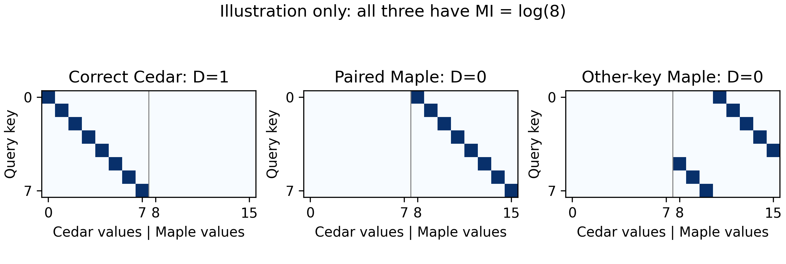
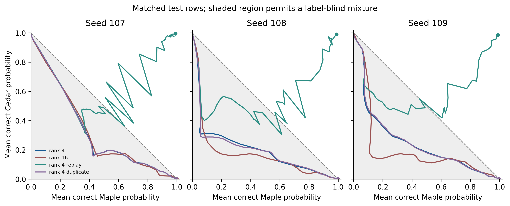
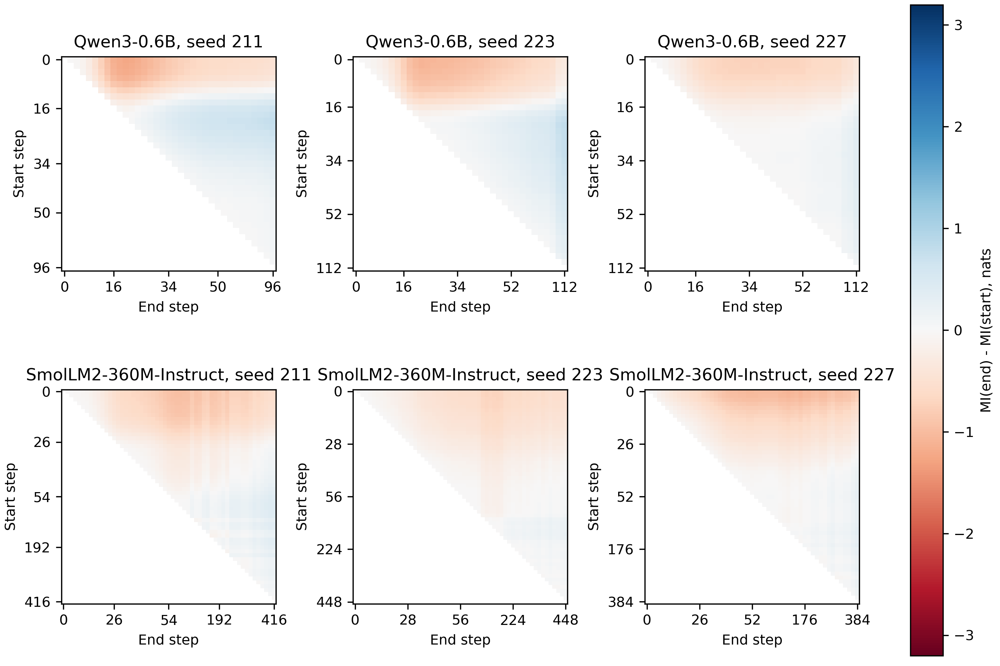
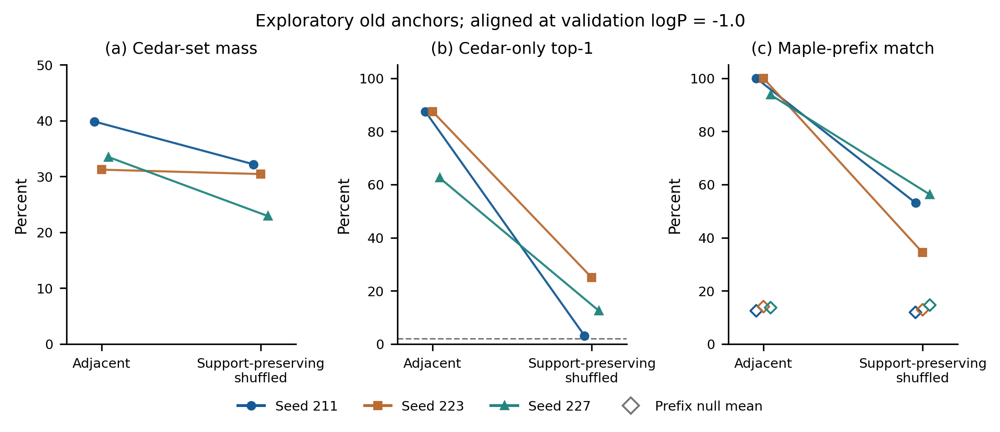

# 共享 LoRA 持续写入中的条件绑定干扰

**第二轮工作稿，2026-11-12 更新。** 本稿区分已完成结果与预定实验；尚不作为可投稿终稿。第一轮发布快照及 PDF 保留供追溯。新增队列完成 17 个分支，其中八个新锚点计划完成 5/104 分支；新增训练尚未完成，本次更新仅含离线分析。摘要的确认性数字暂不定稿。

## 摘要的当前叙事

持续学习的保持评估需要区分模型是否仍依赖查询键，以及这种依赖是否仍指向正确的旧答案。我们在两套同时有效、以注册表标签区分的事实映射上持续更新共享 LoRA，追踪完整候选概率预算，并以同键同上下文的标签干预检验条件绑定。已完成的三个旧锚点对照表明，低目标处的旧值概率不足以排除标签盲混合，而在匹配的 640 步终点，回放同时保持两套答案并产生正确方向的标签效应；普通训练、增加 rank 与重复新样本没有重现这一结果。打散配对下的八个新锚点、高学习目标及扩大目标模块等检验尚未完成；本文当前证据限于小模型和受控事实召回。

> **主要发现（当前证据）**
>
> - 键信息与旧答案正确性是不同的观测量；错误的一一映射也能保留高互信息。
> - 低目标回放的旧质量不能独立说明条件化，尤其不能把不同键集合上的两种概率直接相加。
> - 在三个旧锚点、相邻配对的等步数实验中，回放的两任务质量之和显著超过 1；这一读数同时具有正确方向的注册表路由。打散配对的新锚点总体结果尚未形成。

## 1　问题

语言模型持续接收新事实时，旧提示可能开始生成最近写入的答案。这种变化可以表现为旧答案概率下降，也可以表现为输出仍随查询键变化、但变化已经对应另一套事实。只观察输出是否区分不同键，无法判断旧绑定是否恢复。

本文考察两套同时有效的映射：Cedar 中键 k 对应 c_k，Maple 中同一键对应另一个值 m_k。两种提示仅在注册表标签上不同。学习目标是根据标签调用各自的值，因而这不同于宣布旧事实已经失效的无条件覆盖。训练顺序为先掌握 Cedar，再只用 Maple 或 Maple 与 Cedar 混合样本更新同一组 LoRA 参数。

实验围绕三个问题展开。第一，键依赖恢复时，概率流向正确旧值、同键新值还是其他键的值？第二，旧值与新值的同时保留是否超过完全忽略标签的混合所能达到的范围？第三，这些读数是否依赖学习率、更新预算、答案配对结构或 LoRA 的可更新范围？互信息分解和概率界作为审计工具使用，不作为新信息论结果或新优化算法提出。

## 2　相关工作

LoRA 通过低秩残差适配冻结模型 [1]。Biderman 等已系统研究其学习与遗忘权衡，并比较学习率、rank、缩放和目标模块 [2]；Mirzadeh 等说明训练设置本身会改变持续学习结果 [3]。经验回放也是已有方法 [4]。因此，本文的回放、低学习率和 rank 对照承担解释现象的作用，不构成方法创新。LoRA+ 与 rsLoRA 分别研究 A/B 学习率和 rank 缩放 [5,6]；本文采用同率 AdamW 和固定有效 scale=2，不能把 rank 扫描解释为消除优化尺度影响后的纯容量实验。

旧知识的行为失访未必等于存储擦除。Palit 等在受控召回中观察旧事实先崩溃、再恢复、再缓慢下降，并研究共同表示位移的影响 [7]；O'Neill 等在顺序写入中报告行为遗忘及最近事实进入错误回答的现象 [8]。本文的互信息恢复可以由错误新答案形成，因此不等同于这些工作中的正确旧事实恢复，也不凭输出轨迹推断共同表示位移。

关联记忆视角将事实写入与键表示重叠联系起来 [9]。本文共享完全相同的键，是输入身份重叠的受控极端情形，尚未测量其隐藏表示的重叠程度。Feng 与 Steinhardt 通过激活干预研究上下文中的实体绑定 [10]；本文的标签干预只识别输入字符串对行为分布的作用，不能据此定位 binding ID。答案类别的分析参考上下文更新失败工作中区分当前值、旧值、其他变量值与其他答案的做法 [11]。

任务身份是否在测试时提供，是已有持续学习评估的重要区分 [12]；任务混淆也已在类增量分类中得到专门研究 [13]。附录 A 借用外部限制答案集合的诊断思路，但原提示中本已提供注册表标签，因此该约束不同于再次给模型一个文本标签，也不作为本文提出的新学习方法。

## 3　任务与测量

### 3.1　任务构造与独立单位

Cedar 有 48 个事实，按原题与换键变体组成 24 个键族。主实验旧阶段使用原题、等价改写和换键三联，验证原题相对基座至少提升 12.5 pp，且三联正确率至少 75%。上下文按编号分为训练 14、验证 3、测试 6，同一事实跨集合复用；前缀模板跨集合复用，故这不是未见事实或开放措辞泛化检验。

Maple 更新固定选中的 16 个键族，包含 32 个活跃事实。D、M 与混合界的主比较限其中 16 个原题键，每键使用相同的两个测试上下文，Cedar 与 Maple 提示一一配对。历史互信息轨迹与窗口热图继续使用全部 24 个原题键；24 键的旧质量另作次要汇总，禁止与只在 16 键上计算的 Maple 质量相加。种子是重复单位，上下文不是额外独立种子。

相邻整数臂的旧、新值共享前两个数字 token。支持集保持打散臂在活跃原题、活跃换键和非活跃集合内部打散 Maple 值，保留每组的答案支持集并破坏旧、新值的两位前缀配对。它仍保留整数首 token 等结构，不等于消除所有词元相似性。旧六字母非数值臂因候选覆盖不足退出主结论。

### 3.2　候选矩阵与质量预算

图 1．理想候选矩阵示意，非实测数据。旧值对角线、同键新值平移对角线与换键新值对角线都可以区分键；只有第一种答对旧任务。

Y 表示规范完成 token 序列及 EOS。候选由互斥 Cedar 值、Maple 值和一个“其余”事件组成，不对候选集重新归一化。以 S 表示答案来源集合，有

$$I(K;Y)=I(K;S)+\sum_s P(S=s)I(K;Y\mid S=s).$$

集合内项使用联合分布诱导的 P(K|S)，并按来源质量加权。其余被粗化为单一事件，其条件互信息为零。确定地输出正确旧值与确定地输出同键新值，都可以有 I(K;Y)=log |K|。因此同时报告互信息、正确质量和完整错误去向。

|符号|定义|
|---|---|
|D|同一测试集合上 P(c_K\|K,Cedar) 的算术平均|
|M|同一测试集合上 P(m_K\|K,Maple) 的算术平均|
|Σ|D+M−1|
|R_C|P(c_K\|K,Cedar)−P(c_K\|K,Maple) 的平均|
|JS、TV|逐题共同粗化分布的 Jensen–Shannon 散度、总变差，再取平均；JS 单位 nats|
|L_t|独立 Maple 验证上下文中正确规范完成序列的平均 logP|

Cedar 提示下的预算分为正确 Cedar、其他 Cedar、同键 Maple、同题族换键 Maple、其他活跃原题 Maple、其他活跃换键 Maple、非活跃 Maple、其余，逐行核对总和为 1。数字答案按完整序列及 EOS 评分，不能把规范概率等同于自由生成准确率。

### 3.3　标签盲混合界与有方向的路由

若两种标签下的分布相同，互斥答案满足 D+M≤1。对于一般分布，逐题以 Maple 标签分布 q、Cedar 标签分布 p 表示，有

$$p(c_k)+q(m_k)-1\leq p(c_k)-q(c_k)\leq TV(p,q).$$

对相同题目取平均，并使用 JS 的总变差界与 Jensen 不等式，得到

$$\Sigma\leq R_C\leq \overline{TV}\leq\sqrt{2\,\overline{JS}}.$$

Σ>0 排除完全标签盲的行为分布；Σ≤0 不证明标签盲。正 JS 只能说明两个分布不同，不能说明区别方向正确，所以同时报告 R_C。比值 D/(1−M) 是同一个混合界的另一种表达，不作为独立创新指标；分母接近零时不报告不稳定比值。所有界限在同一候选粗化空间上检查。

目标 L=−1.0 对应的几何平均概率仅约 0.37，不能称为较高新任务质量；它也不能约束独立测试集上算术 M 必须为该数值。高目标比较增加 −0.5、−0.3、−0.1，并保留实际 M。候选外质量、上下文差异与完成格式仍需单独检查。

### 3.4　进度、预算与登记

等进度比较对整条验证轨迹做等检查点权重 PAVA 单调回归，在首次达到目标的相邻检查点间插值概率矩阵，再计算 JS、TV、比值等指标。PAVA 使用未来观测，是回顾性对齐，不能当作在线检测器。原始首次越过、实际检查点的贪心解码同时保留；未覆盖目标不外推或记零。

新锚点每两步保存至 64，之后每 16 步保存；同时报告固定 640 步与终点。至少训练 640 步，最多 1280 步，只有达到 −0.1 且验证平台期连续两次通过才提前结束。平台期在最近两个 64 步窗口中检查 Cedar 与 Maple 的验证 logP 均值变化和波动，规格在第一个新锚点开始前公开修订。未通过者标为预算终点，不称数学收敛。

逐次记录有效 LoRA 矩阵更新的 Frobenius 路径。历史续训只从恢复点起记录精确路径，较早稀疏适配器检查点的弦长和只能作为下界。学习进度、实际步数和路径分开报告，不能用相同目标代替相同更新距离。

## 4　当前结果

### 4.1　低目标解释的修正

对原 33 条完成轨迹作同键同上下文审计。三个旧锚点 107–109 的 rank-4 回放，在 L=−1.0 处，D、M 的种子均值分别为 46.30%、47.12%，平均 Σ=−0.0658。原约 61% 的 D 来自 24 键汇总，不能与 16 键的 M 直接组合为条件化证据。单种子 Σ 分别为 −0.0910、−0.1195、+0.0132，也不能将均值的负号解释为每个种子都满足盲混合。

在 −0.5 处，D、M 均值为 51.66%、68.28%，平均 Σ=+0.1993。该结果说明继续提高新任务目标会改变解释，但这些已多次分析的种子仅提供探索性证据。完整预算、原始与拟合交点均已公开。

### 4.2　匹配 640 步的回放、rank 与重复暴露

|条件|D 范围 %|M 范围 %|Σ 范围|
|---|---|---|---|
|rank-4 普通|0.093–0.201|99.571–99.649|−0.0026 至 −0.0023|
|rank-16 普通|0.014–0.036|99.887–99.939|−0.0008 至 −0.0003|
|rank-4 重复 Maple|0.089–0.210|99.547–99.634|−0.0028 至 −0.0024|
|rank-4 回放|98.506–99.492|98.916–99.066|+0.9742 至 +0.9856|

表 1．旧锚点 107–109、相邻配对、lr=3e-4，同一 16 个活跃原题键、两个测试上下文。范围是三个种子的最小值和最大值，不是置信区间。

回放终点的 R_C=0.9802–0.9903，说明标签效应具有保留正确旧值的方向。普通分支即使增加 rank 或把每步四条 Maple 逐字重复到八条，仍几乎失去旧正确质量。这一对照匹配更新步；重复分支与普通分支的 token 平均数学梯度相同，有限精度可造成数值差异，不能将其表述为所有批量或新样本多样性效应均已排除。

图 2．灰区表示完全标签盲混合不能被 D、M 排除的区域，终点以圆点标注。曲线按实际训练顺序连接，没有按有利的旧值或新值概率排序。

### 4.3　打散配对的新锚点：尚未完成的主检验

预定锚点为 401、409、419、431、443、449、457、463。每锚点执行 lr∈{1e-4,3e-4,1e-3}、rank∈{4,16}、普通/回放，共 96 分支，并增加八个 lr=3e-4、rank-4 重复 Maple 对照。学习率差和回放差均在种子内计算，分别列出逐种子差、方向一致数、目标覆盖数；不比较两个重叠范围来替代配对分析。

目前种子 401 的 lr=1e-4、rank-4 配对已完成。在 −0.1 的验证进度处，普通分支 D=0.60%、M=87.82%、Σ=−0.1158，回放为 D=93.42%、M=85.52%、Σ=+0.7893。回放减普通的 D 差为 +92.82 pp，但覆盖仅 1/8，尚不构成总体确认性结果，也不能据此决定其他种子的保留与否。完整运行进度与缺失在逐种子表中公开，不将部分结果写成跨种子的摘要发现。

### 4.4　窗口与质量流向

两个模型均对所有已记录的 t1<t2 绘制 ΔMI 热图，展示正负窗口，而不是在固定窗口失败后只报告更有利的后来窗口。键邻近结构在矩阵和数值答案不变时，以 2000 次键坐标置换给出机会数校正的零分布。这仍是索引距离分析，不能当作隐藏键表示的语义距离机制。

图 3．两个模型、三个历史配对种子的全部记录窗口，互信息使用 24 个原题键。颜色表示 I(t2)−I(t1)，未选择单一有利窗口。坐标位置按记录检查点的顺序排列，刻度为实际步数；检查点的时间间距不等。

### 4.5　来源约束能否恢复旧排序：探索性读数

在三个既有锚点上，给解码读出一个额外的 Cedar 候选集合约束后，旧答案的相对排序仍随配对结构变化。在验证 logP=−1.0 的对齐位置，48 值受限最高分的旧值命中率从相邻配对的 62.5%–87.5% 降至支持集保持打散的 3.12%–25.00%；后者的 Cedar 集合总质量仍为 22.92%–32.20%。这是事后候选重评分，不是新的原生生成结果；全部目标、实测点敏感性及前缀零参照见附录 A。

## 5　尚待运行的解释性检验

新增辅助计划已单独登记，等待主队列成功结束后串行执行。全层 Q/V 和全解码器线性投影共享同一 Cedar 起点，新加低秩分支从零残差开始；它们检查新阶段可更新范围，不能代替全层学习 Cedar 的实验。封闭词表使用 48 个跨两模型 tokenizer 都为单 token 的互斥词，16 个键和三套注册表，每个注册表分配 16 个词。真实事实使用 8 个职位在三个明确日期的任职者，含 24 个规范候选及逐项官方来源。

两个辅助任务均先冻结措辞、候选、种子和覆盖要求，再运行模型。封闭词表任一已训练标签的终点平均其余质量高于 2%，则不作为主文高覆盖证据；原始失败仍保留。它们现已完成输入重建和概率预算的 CPU 校验，GPU 技术检查与训练尚未执行。不得用这批输入证明跨模型、真实事实或三注册表效度已经成立。

## 6　证据范围与局限

当前主要限制是打散配对的新锚点尚未全部完成。旧种子多次分析、相邻整数共享前缀，都会限制解释；匹配 640 步的强回放终点不能直接推广到打散任务。原非数值臂覆盖失败，已退出主结论。高目标使用独立验证上下文，实际测试新质量和生成准确率必须同时呈现。

模型范围为本地小模型，当前新增主训练仅 Qwen3-0.6B；SmolLM2 的历史窗口结果不同，不能用单个替代窗口表述统一早期反弹规律。目标模块、缩放与优化设置会影响结果，同率 LoRA 也不是 LoRA+/rsLoRA 的优化后对照。输出标签干预证明输入效应，尚未识别其内部实现，更不能断言旧知识被擦除或保存在某个子空间。

主实验上下文切分依靠编号，事实本身重复；后续辅助任务改用不同措辞模板，但真实事实仍仅 8 个职位，模型也可能已在预训练中掌握。候选集和格式要求属于评估条件，不能将规范完成概率或允许候选列表下的解码当作无提示开放事实问答能力。范围在扩展完成后按实际结果修订，不预先保证它们支持主假设。

## 7　复现与证据索引

公开仓库：[soloduist-pixiv/lora-binding-interference](https://github.com/soloduist-pixiv/lora-binding-interference)。第一轮 release 保持不变；当前工作稿、协议、已完成运行的候选矩阵和审计表在 main 分支公开。未完成运行不作为完成数据上传，基座模型不随包分发。

|主张|可核对证据|必要对照与当前状态|
|---|---|---|
|低目标不能单独证明条件绑定|[同观测集合概率审计](https://github.com/soloduist-pixiv/lora-binding-interference/blob/main/outputs/binding_revision2_20261111/离线审计.md)|原 33 轨迹完成；已撤回跨集合组合解释|
|回放在等步数后能实现有方向的两任务调用|[固定预算与原生解码](https://github.com/soloduist-pixiv/lora-binding-interference/blob/main/outputs/binding_revision2_20261111/固定预算对照.md)|12 个旧种子分支完成；普通/rank/重复暴露参照|
|打散配对上的学习率及回放效应|[新锚点逐种子配对差](https://github.com/soloduist-pixiv/lora-binding-interference/blob/main/outputs/binding_revision2_20261111/新锚点配对差.md)|八锚点预定，尚未完成总体比较|
|错误质量去了哪里|[完整预算](https://github.com/soloduist-pixiv/lora-binding-interference/blob/main/outputs/binding_revision2_20261111/完整质量预算.md)|所有已完成新增分支的各目标、640 步及终点|
|扩大目标范围、非数字、真实事实与三注册表|[后续阶段登记](https://github.com/soloduist-pixiv/lora-binding-interference/blob/main/paper/revision2_protocol.md)|输入冻结、训练待执行|

主训练为 BF16 冻结基座、FP32 适配器，规范候选评分使用 FP32；AdamW β=(0.9,0.999)、ε=1e-8、weight decay=0，无学习率调度或梯度裁剪，损失按答案与 EOS token 平均。单 NVIDIA GeForce RTX 4060 Laptop GPU，本轮运行记录为 PyTorch 2.10.0+cu130，rank-4 主分支有 81,920 个可训练参数。基座加载前检查空闲显存，全部 GPU 训练串行。其他软件版本、实际锚点门槛、样本暴露和各阶段路径保存在每次运行的 protocol、anchor 与 trace 中。源程序及哈希清单见仓库，不依赖论文中的私有相对目录。

## 参考文献

1. Hu 等．LoRA: Low-Rank Adaptation of Large Language Models．2021．[arXiv:2106.09685](https://arxiv.org/abs/2106.09685)。
2. Biderman 等．LoRA Learns Less and Forgets Less．TMLR，2024．[arXiv:2405.09673](https://arxiv.org/abs/2405.09673)。
3. Mirzadeh、Farajtabar、Pascanu、Ghasemzadeh．Understanding the Role of Training Regimes in Continual Learning．NeurIPS，2020．[arXiv:2006.06958](https://arxiv.org/abs/2006.06958)。
4. Rolnick、Ahuja、Schwarz、Lillicrap、Wayne．Experience Replay for Continual Learning．NeurIPS，2019．[arXiv:1811.11682](https://arxiv.org/abs/1811.11682)。
5. Hayou、Ghosh、Yu．LoRA+: Efficient Low Rank Adaptation of Large Models．2024．[arXiv:2402.12354](https://arxiv.org/abs/2402.12354)。
6. Kalajdzievski．A Rank Stabilization Scaling Factor for Fine-Tuning with LoRA．2023．[arXiv:2312.03732](https://arxiv.org/abs/2312.03732)。
7. Palit、Draye、Zucchet、Jin、Schölkopf．When Forgetting is not Catastrophic: On the Mechanics of Spurious Forgetting．2026．[arXiv:2610.08718](https://arxiv.org/abs/2610.08718)。
8. O'Neill、Kirkby、Liu、Psenka．Can a Language Model Continually Learn Facts in its Weights?．2026．[arXiv:2607.11020](https://arxiv.org/abs/2607.11020)。
9. Kaplan 等．Why Fine-Tuning Encourages Hallucinations and How to Fix It．2026．[arXiv:2604.15574](https://arxiv.org/abs/2604.15574)。
10. Feng、Steinhardt．How do Language Models Bind Entities in Context?．ICLR，2024．[arXiv:2310.17191](https://arxiv.org/abs/2310.17191)。
11. Guo、Fang、Gu、Spanos、Demmel、Lavaei．When Context Changes: Understanding Update Failures in LLMs．2026．[arXiv:2609.38866](https://arxiv.org/abs/2609.38866)。
12. van de Ven、Tolias．Three scenarios for continual learning．2019 年预印本．[arXiv:1904.07734](https://arxiv.org/abs/1904.07734)。
13. Nori、Kim．Task Confusion and Catastrophic Forgetting in Class-Incremental Learning: A Mathematical Framework for Discriminative and Generative Modelings．NeurIPS，2024．[arXiv:2410.20768](https://arxiv.org/abs/2410.20768)。

其他历史引用的作者、年份、出版标识核对见 [原有文献标识符](https://github.com/soloduist-pixiv/lora-binding-interference/blob/main/paper/reference_identifiers.md) 与 [新增六篇引用范围核对](https://github.com/soloduist-pixiv/lora-binding-interference/blob/main/paper/revision2_reference_audit.md)。

## 附录 A　候选来源约束的探索性诊断

本节在查看既有结果和两轮评阅后提出，不计入新锚点的确认性结果。其计算规格单独冻结并公开。我们在 47 个完成的数字答案分支记录上重新评分，排除三个覆盖不足的字母臂；续训副本与共享锚点不构成额外独立种子。

给定 Cedar 的 48 个已学规范答案集合 $\mathcal C$，读出只允许在该集合中选择完整序列概率最大的答案。并列者按并列数的倒数计分，零集合质量不定义条件读数。它额外使用了答案来源信息，不是原生逐 token 贪心生成，也不说明模型自行利用了提示标签。另报告同一活跃 16 键的旧值子集版本。

如果变化仅表现为对旧集合统一缩放，即对每个查询存在正系数 $a_t(k)$，使

$$p_t(y\mid k,\mathrm{Cedar})=a_t(k)\,p_0(y\mid k,\mathrm{Cedar}),\qquad y\in\mathcal C,$$

则旧集合内部的概率比和最高分答案都不改变。这只是规范事件层面的受限解释，不是神经表示机制。候选来源约束下的旧值排序发生变化，说明旧集合总质量的变化不足以单独描述观测，但不能推出内部存储已被擦除。

|种子|配对|Cedar 原始集合质量 %|48 值受限旧值命中 %|受限预测与同键 Maple 共享前两位 %|
|---|---|---|---|---|
|211|相邻|39.86|87.50|100.00|
|211|支持集保持打散|32.20|3.12|53.12|
|223|相邻|31.24|87.50|100.00|
|223|支持集保持打散|30.45|25.00|34.38|
|227|相邻|33.48|62.50|93.75|
|227|支持集保持打散|22.92|12.50|56.25|

表 A1．同一验证目标 −1.0，PAVA 进度对齐后插值概率矩阵，再计算受限排序。起点的 48 值受限命中率在六个分支中均为 100%。所有观测键的两个上下文，其旧集合质量均大于 1e-4，因此本表的排序差异不是只在近零残留质量上定义。该目标仍较低，不作为同时解决两任务的证据。

相邻减支持集保持打散的逐种子受限命中率差依次为 +84.38、+62.50、+50.00 pp，方向为 3/3 一致。只有三个已分析锚点，不据此进行确认性的种子层推断。

图 A1．同锚点配对的三种读数，点与连线表示单个种子，不绘制跨种子置信区间。(a) 原始 Cedar 集合质量；(b) 外部限制在 48 个旧值中的最高分命中率，虚线为随机标签的 1/48；(c) 受限预测与同键 Maple 的两位前缀匹配，空心菱形为只在训练原题的 16 个 Maple 赋值内置换的精确零参照均值。各图的百分数含义不同，不能把条件准确率当作原始答案概率。

在支持集保持打散臂，受限旧预测与新值的两位前缀匹配为 34.38%–56.25%，高于同一训练集合内置换的约 12%–15% 均值。48 个旧值都经过 Cedar 训练，旧值标签的置换使用全部 48 个；16 值版本仅在活跃 16 键内置换。每个键的两个上下文共同使用一个置换，2000 次零分布与逐种子未校正尾概率完整公开，不以它们替代独立种子确认。

原始首次实测越过 −1.0 的检查点上，相邻臂的受限旧值命中率为 71.88%–84.38%，支持集保持打散为 3.12%–18.75%，方向与插值矩阵相同；实际验证 logP 和步数分别报告，不假设所有实测点质量完全相同。对有生成记录的分支，额外抽取同一 16 键和两个上下文的原生输出，并将全 96 值候选最大概率、48 旧值候选最大概率分列。前两者使用相同序列评分，只有候选范围不同；它们都不同于逐 token 贪心，不能把解码算法差异全归于来源信息。

结果限于规范输出事件：旧候选约束下的正确排序随配对结构改变。两臂初始难度、达标步数和路径仍不同，故不能把差异全归因于数字前缀；单 token 因子实验尚未完成。受限回读失败也不排除其他潜在读出。完整记录见[诊断表](https://github.com/soloduist-pixiv/lora-binding-interference/blob/main/outputs/binding_revision2_20261111/候选来源约束诊断.md)与[计算规格](https://github.com/soloduist-pixiv/lora-binding-interference/blob/main/paper/source_oracle_protocol.md)。
